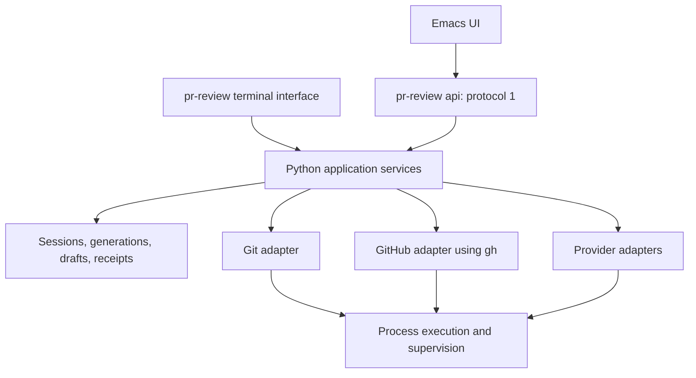

# Python backend migration

Status: planned. This document specifies the migration; it does not describe
completed implementation.

## Decision and intended outcome

Keep both the command-line interface and the Emacs UI. Consolidate application
logic in one Python backend, with a terminal adapter and the existing JSON API
adapter calling the same application services. Keep the Emacs package responsible
for interaction, editing buffers, Magit sections, and presentation.

The migration must preserve saved reviews, human text, publication receipts,
checkpoint reuse, and the ability to recover interrupted work. Its success is
measured by one implementation of each workflow rule, explicit dependencies,
and verified behavior across both interfaces. A smaller line count is desirable
but is not an acceptance criterion.

Complete this migration before substantially extending orchestration for
[proactive repository reviews](proactive-review.md). The shared services should
support that later work without implementing its audit workflow in this change.

## Scope

In scope:

- Replace production Bash orchestration and jq application logic with Python.
- Retain `pr-review`, its existing review arguments, and `pr-review api`.
- Retain the Emacs frontend and protocol version 1.
- Consolidate draft management and publication for terminal and Emacs users.
- Preserve existing GitHub, Git, provider CLI, authentication, and trust behavior.
- Provide compatibility readers for existing artifacts and a tested transition
  from legacy ledgers to the shared draft model.
- Update tests, installation, Guix packaging, and documentation.

Separate work:

- An Elisp backend, web UI, persistent backend server, or background scheduler.
- Direct provider HTTP APIs, replacement of `gh` authentication, or a Git library.
- New review modes, changed prompts, new default models, or a different review
  execution order.
- Automatic transfer of human edits between changed analyses.
- A database conversion, automatic history pruning, or a portability project.

Continue supporting the currently documented Linux environment and Python 3.9+
baseline during the migration. A minimum-version change requires an explicit
compatibility decision and packaging update. New code must work on the declared
minimum version. Retaining POSIX locks and Linux process identity checks is
acceptable; removing Bash does not itself establish support for other systems.

## Existing implementation and migration sources

The backend is already divided between Bash and Python. The Python package
contains application behavior as well as protocol handling; retain and refactor
that work instead of rebuilding it.

| Current source | Responsibility | Destination |
| --- | --- | --- |
| `bin/pr-review`, `lib/core.sh` | Entry point, arguments, dependencies, settings, manifest updates, exit/signal handling | Python entry point, terminal adapter, configuration, storage, operation services |
| `lib/repository.sh` | Repository discovery, authentication, private refs, worktrees, snapshots, context collection | Git/GitHub services and PR workflow |
| `lib/models.sh` | Provider commands, environment filtering, probes, events, supervision, cache identities, review stages | Provider adapters, process supervisor, cache and review services |
| `lib/discussion.sh` | Complete discussion collection, pagination, normalization, review status | GitHub/discussion services |
| `lib/contributions.sh`, `prompts/*.jq` | Finding validation, matching, reassessment, proposal reconciliation | Validation and contribution services |
| `lib/attempts.sh`, `lib/revisions.sh` | Replacement generations, promotion, snapshot-update journals, historical edits | Session/generation storage and Git snapshot services |
| `lib/publication.sh` | Legacy terminal interaction and publication | Terminal adapter, compatibility reader, shared publisher |
| `lib/followup.sh` | Limited review orchestration | Follow-up workflow using shared services |
| `lib/api-bridge.sh` | Python-to-Bash refresh, validation, and adaptation | Direct Python service calls |
| `lib/pr_review_api/` | Drafts, state, context, settings, discovery, operations, publication, protocol, terminal adapter | Reused Python application core and thin interface adapters |
| `lib/api.py`, `lib/review-settings.py`, `lib/followup-state.py` | Script entry points into Python | Temporary compatibility entry points, removed when callers migrate |

Keep prompt text, JSON schemas, and GraphQL documents as resources. Moving jq
validation into Python must preserve its semantic checks, including finding
coverage and discussion membership; validating only JSON shape is insufficient.

## Target architecture

Use a Python package named `pr_review` under `lib/`. The following boundaries are
required; individual files may be combined or split when that improves clarity:

| Area | Owns |
| --- | --- |
| `cli`, `terminal` | Argument parsing, interactive prompts, editor invocation, rendering, exit codes |
| `api` | Protocol decoding/encoding, request validation, capabilities, error mapping |
| `application` | Public use cases, authorization preconditions, transaction boundaries, operation coordination |
| `configuration` | Defaults, saved settings, overrides, provider selection |
| `repository`, `github`, `discussion` | External Git/GitHub operations and complete context snapshots |
| `processes`, `providers`, `operations` | Child lifecycle, provider-specific commands/events, cancellation, operation records |
| `reviews`, `contributions`, `followup`, `cache` | Review pipelines, validation, reuse, matching, reassessment |
| `sessions`, `storage` | Artifact access, locking, journals, generations, atomic writes |
| `drafts`, `publication`, `history` | Human text, staging, placement, confirmation, receipts, recovery |
| `compatibility` | Legacy artifact import and old cache/receipt interpretation |

Dependency rules:

- Neither application services nor infrastructure import the CLI or API adapter.
- Terminal commands call application services directly; they do not serialize a
  protocol request or launch `pr-review api` to reuse business logic.
- API `run` invokes the review application service directly; it does not launch
  the terminal command with `--no-publish`.
- Both interfaces use the same validation, mutations, publication preparation,
  confirmation checks, and receipt recovery.
- Domain functions return values or domain exceptions. They do not print, read
  stdin, display confirmation prompts, or consult UI buffers.
- Progress is emitted through an injected event sink. The terminal renders it;
  the API maps it to protocol events. Provider output stays in the appropriate
  private logs unless an existing explicit view requests it.
- Use explicit configuration, snapshot, session, draft, and operation objects.
  Dataclasses and type annotations are appropriate; avoid recreating the shell's
  shared mutable globals in a Python module.
- Keep state transitions and normalization functions testable without launching
  external commands. Inject command execution, clock, and event delivery where
  meaningful; avoid a general plugin framework or dependency-injection system.

Use the standard library unless a specific unmet requirement justifies another
dependency. The current `subprocess`/`selectors` approach is sufficient for the
initial supervisor. Introducing an async framework is not a migration goal.

## Interface compatibility

### Command-line interface

Preserve these entry points and behaviors:

- `pr-review <number-or-URL>` and all currently documented review, repository,
  reviewer, model, effort, testing, resume, trust, and follow-up options.
- `pr-review api` as the machine interface.
- Source-checkout installation with a symlink to `bin/pr-review`.
- Invocation from a repository subdirectory or secondary worktree.
- Existing environment settings for state location, model limits, authentication
  probes, permission mode, and external editor selection.
- Noninteractive execution and `--no-publish` never publish. A noninteractive
  trust requirement fails with actionable information unless the exact trusted
  snapshot was explicitly supplied.
- Saved pending/current settings and explicit command-line overrides retain
  their existing precedence. Freeze resolved settings for confirmation retries.
- Helpful progress, artifact locations, failure diagnostics, and resume guidance.

The CLI remains a supported human interface. Its shared draft workflow must
support inspection, editing, placement, staging/unstaging, suppression/restoration,
explicit verdict selection, exact preview, confirmed publication, receipt
recovery, and historical text recovery. Expose creation of a human comment and
inspection of full conversations and saved source context without requiring
Emacs. Equivalent operations need not have identical presentation in both UIs.

The terminal publication menu will intentionally converge on the existing API
draft model. New model proposals start Unstaged; an explicit stage action selects
them for publication. This changes the legacy terminal's automatic selection of
some proposals and must be documented, shown clearly in the menu, and tested.
Retain bulk staging with the same blockers as Emacs. Do not introduce automatic
staging to emulate old defaults.

Menu wording and keys may change where needed for that convergence. Do not
silently retain an old key with a broader publication effect. Update terminal
help, README examples, and interactive tests together. Preserve familiar actions
where their meaning is unchanged.

External editing uses an argv list, never shell evaluation. If an edit is rejected
as stale, retain its text in a recoverable location and report how to recover it.
The terminal must not discard the only edited copy when a temporary editor file
is closed. EOF or a declined confirmation leaves saved drafts available.

Preserve established exit behavior: successful execution exits zero; failed
operations exit nonzero; CLI SIGINT and SIGTERM use 130 and 143. Characterize
other exit statuses before replacing the parser. Human-readable output is not
a replacement for the documented machine interface.

### JSON API and Emacs

[Protocol version 1](api.md) remains the public frontend contract. Preserve:

- One UTF-8 JSON request line, NDJSON events, and exactly one final result/error
  while the response channel remains writable.
- Existing commands, request/response fields, error codes, size limits, explicit
  false/null handling, and capability negotiation.
- Opaque session/generation/revision identities and generation-pinned reads.
- Local reads without credential checks, GitHub requests, paid calls, or legacy
  artifact rewrites. Explicit refresh/model operations retain their boundaries.
- Started/progress events, operation IDs, logs, cancellation, and structured
  trust-confirmation information bound to an exact snapshot.
- Stale-editor protection, unsaved text retention, immutable history, and explicit
  opening of newly completed generations.
- Model discovery as an independent cancellable operation with its own deadline.

Do not require an Emacs rewrite for the migration. The existing executable
customization continues to point at `pr-review`. Additive protocol improvements
are allowed when needed, documented, and covered by compatibility tests; changing
the implementation language does not justify a protocol-version bump.

## Behavioral requirements

### Repository, GitHub, and review execution

Preserve the existing repository and snapshot protections:

- Explicit host/repository identity, unambiguous remote selection, and PR-number
  scoping. Retain enterprise-host handling and forks fetched through base-repo
  PR refs without adding fork remotes.
- Private refs and detached worktrees; caller branches, index, and ordinary
  remote-tracking refs remain untouched by review setup.
- Metadata/ref consistency checks, merge-base selection, and historical base
  handling for closed or merged PRs. Publication remains disabled for them.
- Worktree identity and integrity checks before/after model execution and before
  publication. Preserve tracked-change rejection and treatment of generated,
  untracked, and ignored files.
- Unique automatic resume, explicit `--resume`, ambiguous-match rejection, and
  recovery of interrupted worktree movement/setup.
- Existing CLI support for explicitly resumed artifacts outside the default
  state root. Keep API session-path restrictions at the API boundary; an internal
  service must not accidentally make the CLI less capable or loosen API input.
- Git invocations retain the existing hook, external-diff, textconv, and quoting
  protections appropriate to each operation.

Continue using Git and `gh` through argv invocation. Preserve CLI-managed
credentials and the existing authentication sequence, including live model
probes before worktree preparation. Do not perform probes on local reads or use
a migration test that silently incurs model usage.

Preserve complete pagination, GraphQL error handling, REST/thread consistency
checks, and all-or-nothing cache replacement. A partial discussion fetch must
not become an apparently complete snapshot. Keep discussion content fingerprints
separate from review-status metadata and exclude only verified own publication
receipts from external-activity comparisons.

Retain single-provider and dual-provider execution, provider independence,
processing-provider selection, focused/full testing policy, and bounded
reassessment behavior. Policy limits in prompts remain distinct from an optional
hard process deadline. Follow-up keeps limited coverage, exact selected-thread
validation, and no automatic carryover of drafts or overall recommendation.

### Process lifecycle and progress

Provide one reusable execution facility with policies for short commands,
metadata discovery, authentication probes, and long model stages. Provider adapters
build commands and interpret events; they do not each implement signal escalation.

Requirements:

- Pass argv, cwd, and an explicit environment without `shell=True` or evaluated
  shell fragments. Preserve provider-specific credential exceptions and removal
  of Git configuration overrides as a complete group.
- Launch supervised children in owned process groups/sessions. Close unrelated
  descriptors, including repository locks, in children. Model descendants must
  not keep a lock alive after the owner exits.
- Drain stdout and stderr without deadlock, log incrementally, handle arbitrary
  read boundaries and partial final records, and bound pending-record memory.
  Parse complete model events once rather than rescanning the accumulated log.
- Preserve heartbeat elapsed time, silence diagnostics, retryable versus terminal
  event handling, and failure detection even when a provider exits zero.
- Keep ordinary models without a default hard deadline. Retain explicit model
  timeout configuration, authentication-probe deadlines, and model-discovery
  deadlines as separate policies.
- Use a common cancellation token. Signal handlers request cancellation; cleanup
  code escalates through the appropriate signals with bounded waits, terminates
  remaining descendants even if the group leader exited, and reaps children.
- Distinguish cancellation, timeout, provider failure, invalid output, and
  integrity failure. Preserve completed checkpoints and usable diagnostics.
- Finish child cleanup before releasing the PR lock during orderly shutdown.
  A forced process/host crash must instead be recoverable from persisted state;
  it cannot rely on a cleanup handler running.

Keep operation records with an opaque ID, owner PID and verified start identity,
repository/PR ownership, status, and log path. Cancellation verifies ownership
before signalling, and stale records never authorize signalling a reused PID.
The Python process executing the application workflow owns its operation record;
there is no extra terminal-CLI process underneath the API.

Closing a review view is independent of cancelling its operation. Define and test
response-pipe loss/editor shutdown separately: request orderly cancellation and
checkpoint preservation rather than leaving uncontrolled descendants. Do not
promise detached execution across Emacs shutdown. A closed pipe cannot receive
a final event; record the outcome in the operation log/state instead.

### Persistence, concurrency, and generations

Reuse the current artifact layout initially. In particular, preserve session
directories, manifests, `.current-review`/`.pending-review` selectors, history,
private Git refs, and existing opaque identities. Reuse identity algorithms;
renaming a Python module must not create a new generation.

Centralize filesystem changes:

- Create private artifacts with the existing restrictive permissions.
- Write JSON through unique temporary files in the destination directory, flush
  and sync, then atomically replace and sync the containing directory. Clean up
  temporary files on ordinary failure without deleting committed state.
- Use explicit serialization rules. Distinguish byte-oriented artifacts and
  provider logs from decoded application text.
- Keep candidate generations separate from the current completed generation.
  Preserve journals for multi-step worktree updates and publication resets.
- Promote only a complete, validated candidate through atomic pointer replacement.
  Retain historical drafts and receipts, and pin the Git objects needed for later
  source views after force-pushes or garbage collection.
- Make journal replay idempotent. A crash after any recorded transition must
  either leave the prior current generation usable or finish the intended
  transition without repeating completed model/publication work.

Retain the existing lock paths while implementations coexist. Keep a long-lived
repository/PR lock for review execution and short draft transactions per
generation, allowing edits to a previous completed review during a replacement.
Return from review execution and release its lock before entering the terminal
draft menu. Do not hold publication or draft locks across an editor invocation
or a human confirmation prompt; recheck revision and confirmation on acceptance.

For the final Python implementation, operations needing both locks acquire the
PR lock before the draft lock. Draft-only transactions never acquire the PR lock.
Adaptation may snapshot a draft under its lock, release it, then acquire the PR
lock; later acceptance still checks the original revision. Recheck the current
generation after acquiring a draft lock. Promotion coordinates with the old
current generation's draft lock before switching the pointer.

Normal conflicting user operations return `busy`; avoid an unbounded wait while
holding another lock. Existing transitional callers using the opposite order
must remain fail-fast and must be removed or converted before introducing any
blocking acquisition. Add a concurrency test for promotion versus draft save and
for publication versus review start.

### Shared drafts and publication

Make the current API draft model the common model for both interfaces:

- One canonical store of human wording, placement, status, versions, provenance,
  prepared batches, and publication receipts.
- New proposals are Unstaged; duplicates remain Suppressed; placement and bulk
  staging use the same blockers in both interfaces.
- Actual text or placement changes unstage the draft and invalidate preparation.
  Unchanged text preserves staging. Historical and published comments retain
  their existing mutation restrictions.
- New analysis generations get fresh drafts. Earlier wording is recoverable only
  through an explicit user action; no model or heuristic silently transfers it.
- Adaptation returns a suggestion without saving it. Acceptance uses the original
  revision, retaining the suggestion if the draft has become stale.
- An overall verdict is explicit. Model recommendations do not authorize approval
  or request-changes. Preserve self-review restrictions, retained-blocker warnings,
  and limited-coverage warnings.

Both interfaces follow the same publication sequence:

1. Prepare by reconciling uncertain earlier requests, refreshing context, checking
   account/snapshot/placements, and building the exact immutable batch.
2. Present exact wording, destinations, verdict, warnings, and counts. Require
   explicit final confirmation.
3. Publish only with the matching revision and confirmation token. Revalidate
   relevant source/discussion/status before and between writes.
4. Persist intent before each request and retain exact submitted bodies, markers,
   parent review receipts, and individual inline-comment receipts.
5. Reconcile ambiguous results using the existing receipt identity checks. Never
   repost a known parent review because its inline receipts are incomplete.

Preserve partial success: confirmed posts remain Published, unsent work remains
available, and changed dependencies require renewed inspection. Preparation and
publication must not call a model, rewrite approved wording, regroup approved
comments, or perform an automatic retry after an unknown outcome.

## Saved-state and cache compatibility

### Artifact and ledger transition

Local reads remain virtual imports. Preserve source artifacts until an explicit
mutation requires adoption into the canonical draft store. Validate the supported
format version and required structure before modifying state; an unknown newer
format fails without a partial rewrite.

Legacy compatibility must cover:

- Version-1 readable runs and version-2 sessions, current/pending generations,
  nested snapshot archives, and already adopted API drafts.
- Legacy contribution selections, per-proposal edits, combined Markdown edits,
  published actions, and partially completed or ambiguous submissions.
- Existing marker formats, run/generation identities, and receipts. Do not
  regenerate an action identity merely because its reader changed language.
- Absolute paths retained in copied artifacts, including relocation handling
  already supported by the current reader.

Legacy automatic selections do not become staged comments on import. Preserve
human wording and historical selection information for inspection. Preserve
existing explicit staging in adopted API drafts. Keep legacy combined Markdown as
a recoverable document; do not guess how to split it into inline comments.
Explicit recovery may create an Unstaged overall assessment with provenance.

Uncertain legacy publication must be reconciled before replacing its analysis
or adopting a representation that would lose its intent. The terminal must offer
that recovery path; a migration error cannot require users to edit JSON manually.

During coexistence, compatibility projections such as `actions.json` may still be
needed by the shell collector. Give one service ownership of those writes and
test interruption between projection and canonical-store writes. After shell
retirement, read confirmed own receipts from the canonical store, with legacy
fallback. Old ledgers remain historical inputs, not a second editable source of
truth. Generated Markdown reports may remain derived inspection artifacts.

### Cache identity

Treat cache compatibility as a separate migration deliverable. Existing keys
depend on command normalization, JSON byte formatting, prompt paths, schemas,
validator source hashes, input artifacts, and output hashes. A semantically equal
Python dictionary is not necessarily byte-identical to jq output.

Requirements:

- Record representative current input objects, canonical bytes, fingerprints,
  and completed artifacts as fixtures before replacing the implementation.
- Retain a legacy identity calculator where necessary, including path
  normalization and the current handling of runtime limits and streaming flags.
- Verify old input/output hashes and semantic compatibility before adopting a
  completed stage. A language migration alone must not force a paid rerun of a
  verifiable unchanged review.
- Replacing a jq validator or moving a Python validator changes its source hash.
  Define explicit, tested compatibility mappings for known equivalent validators;
  do not simply ignore validator hashes or bless every old cache entry.
- Introduce a versioned semantic validation identity for new cache records so
  unrelated source organization changes do not invalidate reviews. Bump it when
  accepted output meaning changes. Retain prior identity/provenance when upgrading
  a verified legacy record under the session lock.
- Unknown or unverifiable records remain available as history and are recomputed
  only through an explicit run under the normal invalidation rules. Discovery,
  reading, and migration inspection never trigger model calls.
- Preserve dependency invalidation: changes affect the required downstream stages;
  runtime limits and human draft edits do not invalidate completed analysis.

## Delivery stages

Each stage should be reviewable and keep the supported application usable. Keep
the old engine as a development comparison target until the Python workflow is
ready; do not automatically fall back to it after a Python error. A failed attempt
may already have consumed model usage or changed external state.

### 0. Establish the baseline and fixtures

Capture public CLI arguments/environment behavior, protocol responses, artifact
formats, cache identities, provider argv, and the current test results. Establish
a passing full baseline in the supported Emacs/dependency environment before
using test differences to evaluate the migration.

Add deterministic fixtures for current and legacy reviews, edited/staged drafts,
pending replacements, snapshot journals, publication intents, and missing receipts.
Use synthetic content and mocked provider/GitHub responses, with real temporary
Git repositories. Record intentional CLI staging changes separately from behavior
that must remain identical.

Exit criteria: maintainers can replay the important workflows without network or
paid calls, and the compatibility inventory identifies the source of each rule.

### 1. Extract the existing Python application core

Create `pr_review`, move existing application behavior behind service functions,
and make API and terminal adapters depend on those functions. Retain small
compatibility imports/entry points as needed for existing shell callers and tests.
Separate domain errors and progress from NDJSON emission. Establish shared storage,
locking, command execution, and configuration interfaces without changing artifacts.
Keep source-hashed validators and other cache inputs byte-identical until stage 3
provides their compatibility transition. In particular, replacing a hashed module
with an import shim can invalidate cache records even if its behavior is unchanged.

Exit criteria: Python and Emacs/API contracts pass; terminal actions no longer
depend on protocol dispatch for business logic; service code does not import or
print through either interface adapter.

### 2. Replace the GitHub and validation bridge operations

Port repository resolution and publication snapshot validation needed by the
bridge and complete GitHub discussion/status collection. Reuse existing Python
Git context and GitHub code where appropriate. Replace `refresh` and `validate`
bridge calls with direct services. Retain only the adaptation bridge operation
until the provider supervisor is ready in stage 3.

Port discussion normalization and its semantic checks alongside these services.
Verify pagination, account changes, stale source, incomplete context, discussion
fingerprints, and exact own-receipt filtering. Preserve temporary path and cache
compatibility until the cache transition is ready, including byte-equivalent
legacy discussion hashes rather than merely equivalent decoded JSON.

Exit criteria: refresh and validation no longer call `api-bridge.sh`; no protocol
changes; all associated contract, publication, and conversation tests pass.

### 3. Implement provider execution and cache compatibility

Port command construction, capability checks, authentication probes, environment
filtering, event normalization, supervision, structured-output extraction, and
phase cache logic. Reuse the existing Python model-discovery implementation and
share lifecycle primitives while preserving its distinct protocol and deadline.
Move adaptation onto these services and delete `api-bridge.sh` after its last
caller is removed. Adaptation still returns unsaved wording and its input revision.

Exercise the supervisor independently with mock children and descendants. Keep
the full legacy review engine active until the Python workflow can own the entire
run; avoid splitting one model stage's checkpoint ownership between processes.

Exit criteria: command/prompt equivalence, cancellation/escalation, log handling,
timeout behavior, and legacy cache reuse are verified. Successful cache adoption
does not launch providers. Failures do not install a candidate generation.

### 4. Port sessions and review orchestration

Implement session discovery/resume, initialization, worktree preparation, snapshot
updates, generation creation/promotion, and journal recovery. Compose the shared
services into full-review and limited-follow-up workflows. Port contribution
validation/reconciliation and reassessment, retaining the existing stage ordering.

Provide a development-only way to run the old and new engines against independent
copies of deterministic fixtures. Compare normalized results, exact drafts,
provider invocation counts, Git effects, and receipts. Do not run both against one
mutable session or shadow real model/publication operations.

Exit criteria: end-to-end Python review/resume works for all provider modes;
interruption and journal tests pass; old completed generations remain usable
while replacements fail or run; verified stages are reused with the same intended
invalidation behavior.

### 5. Switch both interfaces and unify terminal publication

Replace `bin/pr-review` with a Python entry point that resolves its installation
root correctly when invoked through a symlink. Route both public interfaces to
the shared services. The API no longer launches the CLI to run a review.

Finish the terminal draft workflow, legacy adoption/recovery, and the common
publication implementation. Apply the documented Unstaged-default transition.
Verify alternating CLI and Emacs use on the same session, including edits made
while a replacement is running. Show clear recovery guidance for unsupported or
unverifiable old state.

Exit criteria: both interfaces are complete and use one publisher; no production
request needs Bash orchestration; protocol/ERT and terminal interaction tests pass;
source checkout and packaged installations invoke the correct resources.

### 6. Remove retired runtime code and finalize packaging

Remove unused shell libraries, jq programs, compatibility executables, and import
shims after all callers and fixtures have been accounted for. Retain compatibility
readers and cache mappings needed for supported saved reviews.

Update `guix.scm` to install and wrap the Python entry point and package resources.
Remove runtime dependencies on Bash, jq, GNU text/hash utilities, and external
`flock`/`timeout` when no remaining production operation uses them. Git, `gh`,
Python, and enabled provider CLIs remain runtime dependencies. A user-selected
editor may itself be a shell program; it is not backend orchestration.

Keep Bash/Bats as development dependencies while useful tests use them. Adjust
Makefile targets so Python becomes the production backend check and remaining
shell scripts still receive relevant checks. Update README, Emacs installation
documentation, API implementation notes, and packaging documentation together.

Exit criteria: the full acceptance suite passes from the normal entry points and
the packaged installation, production dependency tracing finds no retired helper,
and migration/rollback limitations are documented.

## Validation strategy

Preserve behavioral tests rather than translating them mechanically. Reuse
black-box Bats cases that invoke `pr-review`; port tests that source shell functions
to direct Python tests. Keep real Git fixtures, mocked GitHub/provider processes,
and the existing Emacs tests that exercise the real API transport.

| Area | Required evidence |
| --- | --- |
| Interfaces | Existing CLI options/environment precedence, protocol commands/errors, Unicode/multiline bodies, source-checkout symlink invocation |
| Read behavior | No network, auth probes, model calls, or artifact mutation during local reads/imports; unchanged opaque identities |
| Repository handling | Subdirectories, secondary worktrees, forks, enterprise hosts, ambiguous remotes/sessions, external explicit resume, historical closed PRs |
| Snapshot integrity | Ref/metadata races, tracked changes, untracked/ignored files, interrupted worktree movement, private-ref and Git-GC history retention |
| Providers | Single/dual modes, processor selection, exact commands/policies, live-probe classification, metadata discovery, malformed/partial event streams |
| Lifecycle | Silent/stubborn children, stderr activity, terminal events with zero exit, cancellation before/after spawn, descendants outliving leaders, stale/reused operation identities, broken response pipes |
| Cache | Legacy verified reuse without calls, serialization/hash compatibility, selective invalidation, candidate path normalization, changed validator semantics |
| Generations | Failure before/after pointer switch, pending resume, promotion versus draft save, old view stays pinned, no unintended edit transfer |
| Drafts | CLI/Emacs alternating edits, staging and blockers, unchanged-edit behavior, placement validation, stale text recovery, legacy combined documents |
| Discussion | Complete pagination, incomplete fetch preservation, thread membership, content versus metadata changes, own-receipt exclusion |
| Publication | Exact preview/send payloads, explicit verdict/confirmation, stale confirmation, account/source changes, partial batches, lost responses, missing inline receipts, no duplicate parent review |
| Follow-up | Exact coverage, focused policy, no overall recommendation, fresh drafts, stale assessments, limited-coverage publication warning |
| Packaging | Supported Python minimum, resource discovery from arbitrary cwd, source and Guix entry points, supported Emacs dependency graph |

Use interruption/fault injection at durable boundaries: after intent persistence,
after a successful remote write but before receipt persistence, after a journal
step, and immediately before/after generation promotion. Assert observable state,
subprocess cleanup, provider/write counts, and retained human text.

Differential comparisons may normalize generated timestamps, temporary paths,
and random identifiers. They must not normalize away body text, placement, stage
reuse, publication decisions, or meaningful state differences. Test canonical
cache bytes separately without normalization.

Run the full backend and Emacs suites at the relevant cutover gates; fast focused
checks are appropriate during individual implementation steps. Live model tests
remain explicitly opt-in and are not the default migration acceptance check.
Verify the Guix closure on a supported host/build environment; a local runtime
check is not equivalent to building that closure. Any unavailable acceptance
check is recorded as outstanding rather than counted as passed.

## Rollout, recovery, and completion

Early stages retain supported artifacts and allow development rollback to the
previous implementation. Before switching a real saved session, verify its format
and preserve the original metadata needed for recovery. Do not run old and new
engines concurrently against that session outside explicit coexistence tests.

After canonical draft adoption or a new format is written, rollback is only to a
version known to understand it. Do not direct an old Bash binary at newer writable
state and assume compatibility. Restoring local files also does not undo GitHub
posts; preserve receipt/intent provenance and reconcile remote outcomes before
any subsequent publication. No rollback procedure should delete history or
regenerate publication markers.

The migration is complete when:

- CLI and Emacs invoke the same Python workflow, draft, and publication services.
- Production paths contain no Bash engine, jq application logic, recursive CLI
  invocation, or Python-to-Bash bridge.
- Supported legacy state remains readable and its human work recoverable; verified
  completed stages can be reused without migration-induced model calls.
- Process ownership, bounded cancellation, locks, generation promotion, and
  publication recovery pass the acceptance scenarios above.
- The terminal provides the documented shared draft workflow, and protocol 1
  remains compatible with the existing Emacs frontend.
- Installation and Guix packaging reflect actual runtime dependencies, the full
  required checks pass, and documentation describes the delivered behavior.
